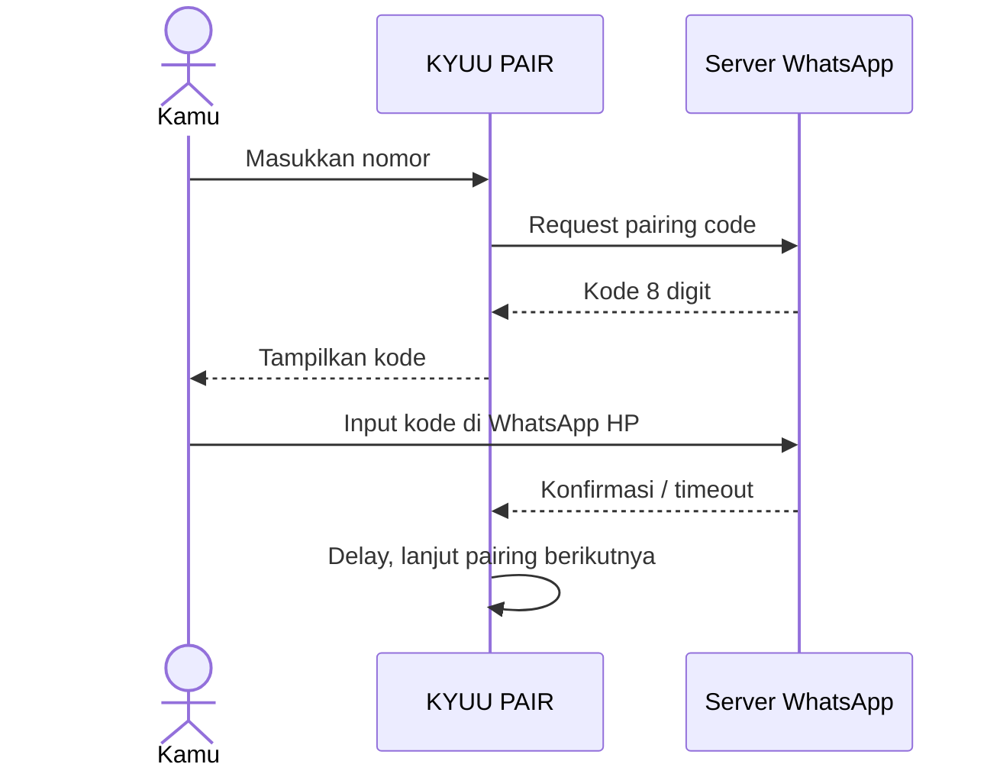

<div align="center">

<br/>


# KYUU PAIR

**WhatsApp Pairing CLI interaktif**

Request pairing code lewat terminal, dengan pairing beruntun ke nomor yang sama. Counter, delay, dan timeout bisa diatur sendiri.

<a href="https://github.com/kyuuXzry/KYUU-PAIR">
  
</a>

<br/>

<a href="https://github.com/kyuuXzry/KYUU-PAIR/stargazers"></a>
<a href="https://github.com/kyuuXzry/KYUU-PAIR/network/members"></a>


<br/><br/>


</div>

<br/>

```text
╭──────────────────────────────────────────╮
│  KYUU PAIR  ·  WhatsApp Pairing CLI      │
│  Pairing code · Beruntun · Tanpa QR      │
╰──────────────────────────────────────────╯
```

## Fitur

<table width="100%">
<tr>
<td width="33%" valign="top" align="center">
<br/>
<b>Pairing via Code</b><br/>
<sub>Tanpa scan QR</sub>
</td>
<td width="33%" valign="top" align="center">
<br/>
<b>Pairing Beruntun</b><br/>
<sub>Default 10x, bisa sampai 1000x</sub>
</td>
<td width="33%" valign="top" align="center">
<br/>
<b>Delay & Timeout</b><br/>
<sub>Bisa diatur mulai 5 detik</sub>
</td>
</tr>
<tr>
<td width="33%" valign="top" align="center">
<br/>
<b>Counter Visual</b><br/>
<sub>Progress bar tiap pairing</sub>
</td>
<td width="33%" valign="top" align="center">
<br/>
<b>Config Persisten</b><br/>
<sub>Tersimpan di <code>config.json</code></sub>
</td>
<td width="33%" valign="top" align="center">
<br/>
<b>Menu Interaktif</b><br/>
<sub>Ulangi pairing tanpa restart</sub>
</td>
</tr>
</table>

Ada juga animasi terminal (spinner, progress bar, box border, typewriter) dan auto-install dependency saat `npm start` lewat `prestart.js`.

## Instalasi

**Prasyarat**

| Kebutuhan | Keterangan |
| :-- | :-- |
| **Node.js 18+** | Disarankan LTS v20 atau v22 |
| **npm** | Ikut terinstall bareng Node.js |
| **Termux** (Android) | Atau terminal Linux / macOS / Windows |

**Langkah**

```bash
git clone https://github.com/kyuuXzry/KYUU-PAIR.git
cd KYUU-PAIR
npm start
```

`npm start` otomatis menjalankan `prestart.js`, yang meng-install dependency kalau belum ada.

<details>
<summary><b>Install Node.js di Termux</b></summary>
<br/>

```bash
pkg update -y && pkg upgrade -y
pkg install nodejs-lts -y
node -v
```

Pastikan versinya `v18` ke atas. Kalau masih `v24` dan error, downgrade:

```bash
pkg uninstall nodejs -y
pkg install nodejs-lts -y
```

</details>

## Cara Pakai

Setelah `npm start`, muncul menu:

```text
[1] Pairing beruntun
[2] Pairing sekali jalan
[3] Pengaturan (target, delay, timeout, nomor)
[4] Reset session (hapus kredensial)
[5] Cek status session
[6] Reset counter pairing
[0] Keluar
```

**Alur pairing beruntun**

1. Pilih menu `[1]`.
2. Masukkan nomor HP target (format internasional tanpa `+`, contoh `6281234567890`).
3. Konfirmasi jumlah dan delay.
4. Script request kode pairing, lalu menampilkannya.
5. Masukkan kode di WhatsApp HP: **Perangkat Tertaut → Tautkan Perangkat → Tautkan dengan nomor telepon**.
6. Tunggu konfirmasi atau timeout.
7. Setelah delay, pairing berikutnya jalan otomatis.



**Format nomor**

| Format | Status |
| :-- | :-- |
| `6281234567890` | Benar |
| `+6281234567890` | Salah |
| `081234567890` | Salah |
| `628 1234 5678 90` | Salah |

## Konfigurasi

Setting tersimpan di `config.json`:

```json
{
  "maxPairing": 10,
  "delayBetween": 5000,
  "timeoutPerCode": 5000,
  "phone": "6281234567890"
}
```

| Field | Default | Range | Keterangan |
| :-- | :-- | :-- | :-- |
| `maxPairing` | `10` | 1 - 1000 | Jumlah pairing beruntun |
| `delayBetween` | `5000` | 5 - 600 detik | Jeda antar pairing (`5000` = 5 detik) |
| `timeoutPerCode` | `5000` | 5 - 600 detik | Batas waktu menunggu kode dimasukkan |
| `phone` | `null` | nomor valid | Nomor target, disimpan otomatis |

Ubah lewat menu `[3] Pengaturan` atau edit `config.json` langsung.

## Struktur Project

```text
KYUU-PAIR
├── package.json
├── prestart.js      # Auto-install dependency
├── pairing.js       # Main script
├── config.json      # Setting (auto-generated)
├── session/         # Kredensial WhatsApp (auto-generated)
└── node_modules/    # Dependency (auto-generated)
```

## Peringatan

> [!WARNING]
> Pairing berulang ke nomor yang sama bisa memicu rate-limit. Server WhatsApp punya sistem anti-abuse. Delay minimal 5 detik, disarankan 15 sampai 30 detik. Nomor juga bisa kena flag kalau terlalu sering request pairing dalam waktu singkat.

> [!IMPORTANT]
> Gunakan hanya untuk nomor milik sendiri. Setiap request pairing code ke sebuah nomor memunculkan notifikasi di WhatsApp pemilik nomor itu.

- **Kode pairing tidak bisa di-custom.** Kode 8 digit di-generate oleh server WhatsApp, bukan oleh script.
- **Jangan share folder `session/`**, karena berisi kredensial WhatsApp.
- **Jangan share `config.json`**, karena berisi nomor HP target.

## Tech Stack

<div align="center">

&nbsp;&nbsp;&nbsp;&nbsp;&nbsp;&nbsp;&nbsp;&nbsp;&nbsp;

<sub>Node.js · npm · WhatsApp · Termux</sub>

<br/>


<br/>

**Author** · KyuuXzry

<a href="https://github.com/kyuuXzry"></a>
<a href="https://wa.me/628567126744"></a>
<a href="https://instagram.com/rissxzry_"></a>

<br/>

<sub>ISC License © KyuuXzry</sub>

</div>
